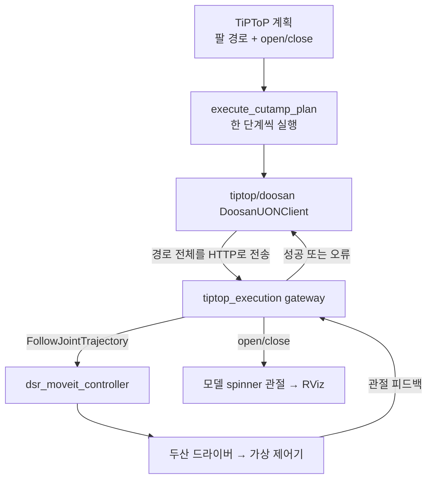

# M1013 가상 ROS 실행 확인

TiPToP에서 관절 경로와 그리퍼 개폐를 순서대로 실행해 gateway → ROS2 → RViz 연결을 확인한다.
팔은 두산 가상 제어기, 그리퍼는 통합 모델 표시를 쓴다. 실물 기동은 [실물 기동](m1013-real-connection.md)을 따른다.

> `tiptop.doosan demo`·`run`은 gateway에 연결된 팔을 실제로 움직인다. 실물 gateway(`--robot-system real`)가 떠 있으면 실행하지 않는다.

## 명령 전달 순서



1. 실행기는 계획의 단계를 순서대로 읽어 팔 경로는 gateway에 한 번에 보내고(고주기 제어를 HTTP로 하지 않음), 개폐는 `open_gripper()`·`close_gripper()`로 보낸다.
2. gateway는 경로를 ROS2 `FollowJointTrajectory` 액션으로 바꾼다. ROS2 쪽은 rad이고 드라이버가 두산 API 경계에서 degree로 변환한다.
3. gateway는 액션 결과·모션 상태·현재 관절값을 확인한 뒤 결과를 반환한다. 요청을 보냈다는 사실만으로 완료로 취급하지 않는다.
4. 한 단계가 실패하면 예외를 내고 뒤의 단계를 실행하지 않는다.

완료 기준:

- **팔**: 액션이 성공하고 `check_motion=0`이며, 모든 관절의 목표-피드백 오차가 `0.5°` 이내인 상태를 연속 세 번 확인한다.
- **그리퍼(모델)**: 명령한 모델 관절과 되돌아온 관절값이 목표 끝점에 도달했는지 확인한다. `force_applied: false`이며 실제 모터 힘이나 파지 성공이 아니다.
- 경로 요청의 `durations[i]`는 i번째 목표까지의 시간이다. 첫 목표는 현재 관절값과 1° 이내여야 하고 마지막 관절 속도는 0이어야 한다.

## 준비

호스트 프로젝트 루트에서 gateway 응답을 먼저 확인한다.

```bash
pixi run python -m tiptop.doosan status
```

| 결과 | 다음 행동 |
|---|---|
| `success: true` | gateway가 실행 중이다. 아래 gateway 실행을 건너뛴다 |
| 팔 피드백 누락·ROS 서비스 오류 응답 | gateway는 실행 중이다. 팔 드라이버·컨트롤러 상태를 확인한다 |
| `Connection refused` | gateway가 없다. 아래에서 실행한다 |
| `timed out` | 실행 여부를 알 수 없다. 기존 gateway 터미널의 오류를 먼저 확인하고 중복 실행하지 않는다 |

컨테이너 진입·빌드는 [워크스페이스 안내](../ros2_ws/README_CUSTOM.md#5-development-environment-setup), 팔 드라이버 실행은 [에뮬레이터 사용](../ros2_ws/docs/m1013-control.md#1-실행과-화면-확인)을 따른다. 컨테이너에서:

```bash
ros2 control list_controllers -c /dsr01/controller_manager     # dsr_moveit_controller가 active여야 함
ros2 run controller_manager spawner dsr_moveit_controller -c /dsr01/controller_manager   # 없을 때만
ros2 run tiptop_execution gateway                                # 127.0.0.1:8090, 없을 때만
ros2 launch m1013_uon_3f_description display.launch.py gripper_gui:=false   # 통합 모델 + RViz
```

`/uon_model/joint_state_publisher`와 `/uon_model/robot_state_publisher`가 이미 떠 있으면 모델 launch는 건너뛴다.
그리퍼 실행부가 모델 관절값을 발행하므로 슬라이더(`gripper_gui`)는 끈다.
준비 후 `status`를 다시 실행해 `success: true`, 관절값 6개, `motion_status: 0`, 그리퍼 `feedback_fresh: true`를 확인한다.

## 실행

```bash
pixi run python -m tiptop.doosan demo
```

RViz에서 **열기 → 팔 이동 → 닫기 → 팔 복귀 → 열기**를 확인한다. `completed_steps: 5`로 끝나면 정상이다.
이동 목표는 시작 관절값에 `[5, -5, 5, 2.5, 2.5, -2.5]°`를 더한 값이며 약 16초 걸린다. 물체나 장애물을 보고 계획한 경로가 아니다.

| 명령 | 동작 |
|---|---|
| `status` | 관절·모션 상태, 그리퍼 피드백 조회 |
| `open` / `close` | 모델 그리퍼 개폐 (`position_rad`: 열림 0.0, 닫힘 1.5009832) |
| `demo` | 위 5단계 시험 |
| `plan` | 박스 없는 showcase 계획을 `tiptop_outputs/m1013/showcase.json`에 저장 ([계획 확인](m1013-planning.md#박스-없는-단독-실행)) |
| `run PLAN.json` | 저장된 TiPToP 1.0.0 계획 실행. `q_init`이 현재 관절값과 맞고 팔 경로가 6관절이어야 함 |
| `stop` | 팔 액션 취소·두산 stop 요청·모델 그리퍼 정지. 중단된 동작은 성공으로 처리하지 않음 |

`stop` 뒤에는 `status`에서 `motion_status: 0`을 확인한다.

## 코드 위치

| 위치 | 역할 |
|---|---|
| `tiptop/execute_plan.py` | 계획 단계 순서와 실패 후 중단 |
| `tiptop/doosan/client.py` | RobotClient 계약과 HTTP 연결 |
| `tiptop/doosan/__main__.py` | 위 CLI |
| `tiptop/utils.py` | `robot.type=m1013_uon`, `dof=6`일 때 클라이언트 선택. host/port는 gateway 주소 |
| `ros2_ws/src/execution/tiptop_execution/` | gateway·궤적 실행·그리퍼 |

## 자동 검사

로봇에 명령을 보내지 않는다.

```bash
pixi run python -m pytest tests/test_doosan_execution.py tests/test_config.py -v
```
