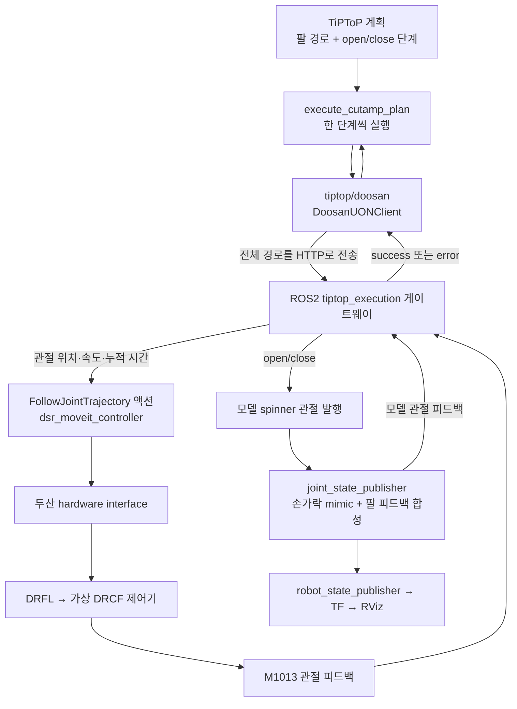

# M1013 + 모델 그리퍼 실행

TiPToP 환경에서 관절 경로와 그리퍼 개폐를 순서대로 실행하고 결과를 확인하는 방법이다.
팔은 두산 가상 제어기, 그리퍼는 통합 모델 표시를 사용한다.
현재 데모는 직접 지정한 경로로 실행 연결을 확인한다. M1013 계획기가 계산한 경로의 연결은 별도 검증 대상이다.

## 먼저 알아둘 용어

- **관절 위치 `q`**: 팔의 관절 1~6이 각각 얼마나 회전했는지 나타내는 여섯 숫자다.
  이 인터페이스에서는 rad를 사용한다. `π rad = 180°`다.
- **관절 경로**: 여러 시점의 `q`를 나열한 것이다. 중간 지점 하나를 waypoint라고 한다.
  경로에는 각 지점의 관절 속도 `qdot`(rad/s)와 이동 시간(s)도 함께 들어간다.
- **계획기**: 물체·로봇·장애물을 보고 경로를 계산한다. TiPToP는 cuTAMP/cuRobo를 사용한다.
- **실행 클라이언트**: 계산된 경로를 장치 실행부에 전달하고 결과를 받는다.
- **게이트웨이**: TiPToP의 요청을 ROS2 명령으로 바꾸는 연결부다.
- **컨트롤러**: 시간에 맞춰 목표 관절값을 처리한다. 여기서는 두산 드라이버에 연결된
  `dsr_moveit_controller`를 사용한다. 이름에 moveit이 있지만 이 과정에서 MoveIt 재계획은 하지 않는다.
- **피드백**: 명령을 받은 쪽에서 실제로 도달했다고 보고하는 관절값이다.

## 명령이 전달되는 순서



1. 실행기는 계획의 첫 단계를 읽는다. 예를 들어 `open`이면 클라이언트의 `open_gripper()`를 호출한다.
2. 클라이언트가 게이트웨이에 요청을 보낸다. 전체 팔 경로는 한 번에 보내며 고주기 제어를 HTTP로 하지 않는다.
3. 팔 요청은 ROS2 `FollowJointTrajectory` 액션으로 바뀐다. 액션은 시작 수락과 최종 결과를 구분하는 인터페이스다.
4. 공식 컨트롤러가 경로를 보간하고, 두산 드라이버가 제어기로 전달한다. ROS2 쪽은 rad를 쓰며
   드라이버가 두산 API 경계에서 degree로 변환한다.
5. 게이트웨이는 액션 결과, 모션 상태, 현재 관절값을 확인한 뒤 클라이언트에 결과를 반환한다.
6. 실행기는 성공한 경우 다음 단계로 넘어간다. 실패하면 예외를 내고 뒤의 그리퍼·팔 단계를 실행하지 않는다.

예를 들어 `open → 이동 → close → 복귀 → open`은 앞 동작의 결과를 받은 뒤 다음 동작을 보낸다.
코드가 요청을 보냈다는 사실만으로 완료로 취급하지 않는다.

## 코드 자동 검사 — 최초 검증·관련 코드 변경 후

호스트의 최상위 TiPToP 폴더에서 실행한다. 테스트용 통신·클라이언트를 사용하므로
ROS2에 명령을 보내지 않으며, RViz와 게이트웨이가 켜져 있어도 실행할 수 있다.
평소 동작 확인은 다음의 직접 실행 절차만 진행하면 된다.

```bash
pixi run python -m pytest tests/test_doosan_execution.py tests/test_config.py -v
```

`-v`는 각 테스트 이름과 `PASSED`/`FAILED`를 표시한다. 현재 기대 결과는 `16 passed`다.

| 검사 내용 | 개수 | 통과 조건 |
| --- | ---: | --- |
| 경로 데이터 전달·시간 변환 | 1 | 위치·속도 값이 유지되고 구간 시간 `[0.05, 0.5, 1]`이 누적 시각 `[0.05, 0.55, 1.55]`로 변환됨 |
| 잘못된 경로 입력 처리 | 5 | 관절 배열 크기 오류, 위치 범위 초과, 0초 시간, NaN 속도, 마지막 비영 속도를 각각 거부함 |
| 팔 실행 실패 후 처리 | 1 | 실패 예외가 발생하고 뒤의 그리퍼 닫기를 호출하지 않음 |
| 기본 설정 읽기 | 1 | 기본 로봇 설정을 읽음 |
| 설정값 변경 | 1 | 지정한 시간 배율을 적용함 |
| 필수 설정 누락 | 3 | 깊이 제한 키, 시간 배율 키, 카메라 섹션 누락을 각각 오류로 처리함 |
| 추가 설정 키 | 1 | 추가 키를 버리지 않고 유지함 |
| 누락 설정 복원 | 1 | 기본값으로 채우고 경고를 남김 |
| 복원 시 사용자 설정 보존 | 1 | 기존 시간 배율·서버 주소를 유지함 |
| 읽은 설정 경로 기록 | 1 | 기본 파일 대신 실제 읽은 파일 경로를 기록함 |

앞의 7개는 실행 코드, 나머지 9개는 기존 설정 코드 검사다. 숫자에 단위가 올바르게 붙었는지
자동 판별하거나 실제 로봇 연결을 검사하는 테스트는 아니다. ROS2 연결과 가상 동작은 아래에서 확인한다.

## 직접 실행

### 1. 실행 연결 준비

**터미널 A — 호스트의 최상위 TiPToP 폴더**에서 먼저 게이트웨이 응답을 확인한다.

```bash
cd /home/uon/workspace/tiptop
pixi run python -m tiptop.doosan status
```

| 조회 결과 | 다음 행동 |
| --- | --- |
| `success: true` | 게이트웨이가 실행 중이므로 아래 게이트웨이 실행 명령을 건너뛴다. |
| 팔 피드백 누락·ROS 서비스 오류 응답 | 게이트웨이는 실행 중이다. 중복 실행하지 않고 아래 팔 드라이버·컨트롤러 준비 상태를 확인한다. |
| `Connection refused` | 기본 주소에서 게이트웨이에 접속하지 못했다. 아래 준비 절차를 진행하고 터미널 B에서 게이트웨이를 실행한다. |
| `timed out` | 실행 여부를 확정할 수 없다. 기존 게이트웨이 터미널의 오류를 먼저 확인하고 중복 실행하지 않는다. |

이어서 필요한 항목만 준비한다. 이미 실행 중인 프로그램은 해당 실행 단계를 건너뛴다.

빌드·컨테이너 진입은 [워크스페이스 설치 안내](../ros2_ws/README_CUSTOM.md#5-development-environment-setup),
팔 드라이버 실행은 [M1013 제어 안내](../ros2_ws/docs/m1013-control.md#1-실행과-화면-확인)를 따른다.

**터미널 B — ROS2 컨테이너에서 팔 경로 컨트롤러를 확인한다.**

```bash
ros2 control list_controllers -c /dsr01/controller_manager
```

`dsr_moveit_controller`가 이미 `active`이면 spawner를 건너뛴다.
이름이 없으면 다음 명령으로 추가한다.

```bash
ros2 run controller_manager spawner dsr_moveit_controller -c /dsr01/controller_manager
```

앞의 조회에서 `Connection refused`가 나왔고 기존 게이트웨이가 꺼져 있다면,
같은 터미널에서 다음 명령으로 실행한다. 이미 응답을 받았다면 실행하지 않는다.

```bash
ros2 run tiptop_execution gateway
```

게이트웨이는 기본 `http://127.0.0.1:8090`에서 요청을 기다린다.
현재 컨테이너의 host network 설정으로 호스트 TiPToP에서 이 주소에 접속한다.

**터미널 C — ROS2 컨테이너에서 통합 모델과 RViz를 연다.**

먼저 실행 중인 모델 노드를 확인한다.

```bash
ros2 node list
```

`/uon_model/joint_state_publisher`와 `/uon_model/robot_state_publisher`가 없으면 다음 명령으로 실행한다.
두 노드가 있고 그리퍼 슬라이더가 꺼져 있으면 모델 launch를 건너뛴다.

```bash
ros2 launch m1013_uon_3f_description display.launch.py gripper_gui:=false
```

그리퍼 자동 실행부가 모델 관절값을 발행하므로 슬라이더는 끈다.
기존 슬라이더 launch가 있다면 해당 터미널에서 종료한 뒤 위 명령으로 다시 실행한다.

통합 모델은 실행 중이고 RViz만 없는 경우에는 모델 launch 대신 다음 명령을 쓴다.

```bash
docker exec -it --user ros ros2-dev bash
ros2 run rviz2 rviz2 \
  -d /workspaces/ros2_ws/install/share/m1013_uon_3f_description/rviz/model.rviz \
  --ros-args -r __ns:=/uon_model \
  -r /tf:=/uon_model/tf -r /tf_static:=/uon_model/tf_static
```

### 2. 연결 재확인

준비를 마친 뒤 **호스트 터미널 A**에서 다시 조회한다.

```bash
pixi run python -m tiptop.doosan status
```

`success: true`는 상태 조회 성공을 뜻한다. 관절값 여섯 개, `motion_status: 0`,
그리퍼의 `feedback_fresh: true`를 확인한 뒤 동작 검증으로 진행한다.

### 3. 개별 동작과 순차 실행

기본 동작 검증은 같은 호스트 터미널에서 데모 한 번으로 확인한다.

```bash
pixi run python -m tiptop.doosan demo
```

RViz에서 **열기 → 팔 이동 → 닫기 → 팔 복귀 → 열기**를 확인한다.
각 단계의 `Completed step`과 최종 `completed_steps: 5`가 나오면 다섯 단계 실행이 완료된 것이다.

데모는 **명령을 시작할 때의 관절값**을 복귀 기준으로 저장한다.
이동 목표는 그 기준에 `[5, -5, 5, 2.5, 2.5, -2.5]°`를 더한 값이다.
각 팔 경로는 현재점·중간점·목표점의 세 점이며, 관절 경로 두 개와 개폐를 합해 약 16초 걸린다.
중간점에서 속도 0을 사용해 처음 관찰하기 쉽게 구성했다.
이 데모는 실행 연결을 확인하기 위한 지정 경로이며, 물체나 장애물을 보고 계획한 경로는 아니다.

그리퍼만 따로 확인하고 싶을 때는 다음 명령을 사용한다. 데모 검증과 별도로 필수 수행할 항목은 아니다.

```bash
pixi run python -m tiptop.doosan close
pixi run python -m tiptop.doosan open
```

성공 응답은 `success: true`, `backend: model`이며, `position_rad`는 닫힘 `1.5009832`, 열림 `0.0`이다.
동작 중 상태는 별도 호스트 터미널의 `status` 명령으로 조회한다. `execution.status`는
실행 중 `running`, 완료 후 `completed`이며, `execution.result`는 마지막 단일 동작의 결과다.

## 완료의 의미

- **팔**: 액션이 성공하고, `check_motion=0`이며, 목표와 피드백의 모든 관절 오차가 `0.5°` 이내인
  상태를 연속 세 번 확인한다. `max_joint_error_rad`는 완료 당시 실제 최대 오차다.
- **그리퍼**: 명령한 모델 관절과 통합 모델에서 되돌아온 관절값이 목표 끝점에 도달했는지 확인한다.
  `force_applied: false`이며 실제 모터 힘이나 물체 파지 성공을 나타내지 않는다.
- **계획**: 모든 단일 동작이 성공해야 마지막 단계까지 진행한다. 실패 시 실행기는 뒤의 단계를 중단한다.

각 경로 요청의 `durations[i]`는 i번째 목표에 도달할 때까지의 시간이다.
예를 들어 `[0.05, 2, 2]`이면 액션 목표 시각은 `[0.05, 2.05, 4.05]`초다.
첫 목표는 현재 관절값과 `1°` 이내여야 하며 첫 시간은 시작점 유지 구간이다.
이는 Bamboo의 각 목표별 duration 계약을 따른다. 마지막 관절 속도는 0이어야 한다.

저장된 TiPToP 1.0.0 계획을 실행하려면 다음 명령을 쓴다. 해당 계획의 `q_init`과 현재 관절값이
맞아야 하고, 팔 경로에는 M1013의 여섯 관절이 들어 있어야 한다.

```bash
pixi run python -m tiptop.doosan run /path/to/plan.json
```

## 중단·종료

진행 중인 실행을 중단하려면 별도 호스트 터미널에서 먼저 실행한다.
팔 액션을 취소하고 두산 stop을 요청하며 모델 그리퍼의 진행도 멈춘다.
중단된 동작은 성공으로 처리하지 않는다.

```bash
pixi run python -m tiptop.doosan stop
pixi run python -m tiptop.doosan status
```

`stop_requested: true`는 중단 요청 전달 결과다. 이어서 `motion_status: 0`을 확인한다.

## 코드 위치

| 위치 | 역할 |
| --- | --- |
| `tiptop/execute_plan.py` | 계획 단계 순서와 실패 후 중단 |
| `tiptop/doosan/client.py` | 기존 RobotClient 계약과 HTTP 연결 |
| `tiptop/doosan/__main__.py` | 상태·개폐·데모·저장 계획 실행 명령 |
| `tiptop/utils.py` | `robot.type=m1013_uon`, `dof=6`인 경우 클라이언트 선택; host/port는 게이트웨이 주소 |
| `ros2_ws/src/execution/tiptop_execution/` | ROS2 액션·피드백·모델 그리퍼 실행 |

TiPToP Python 환경에서 ROS2와 GPU 계획기 의존성을 섞지 않고, ROS2는 컨테이너에서 처리한다.
